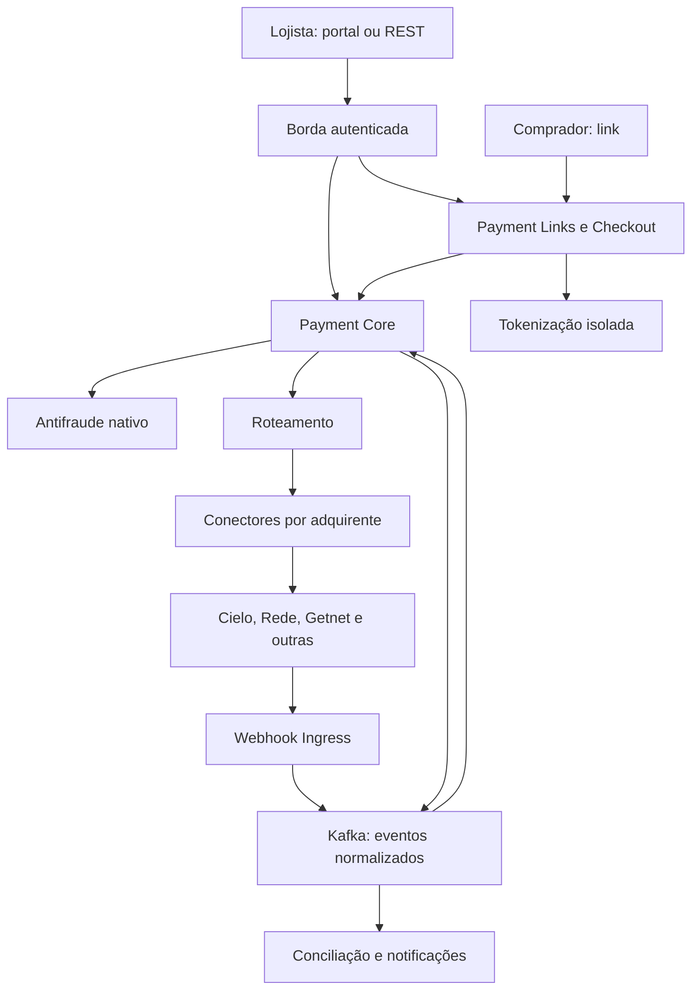
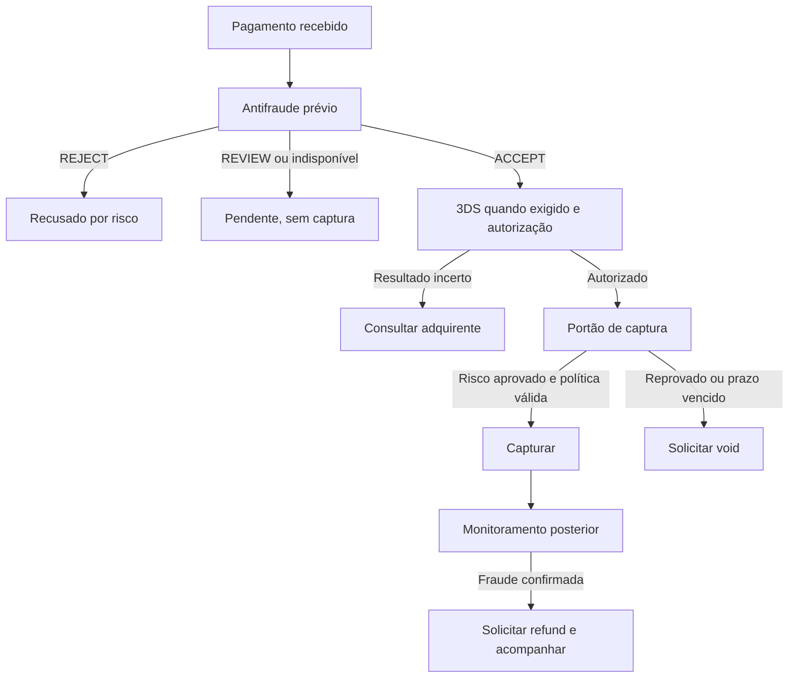

# Gateway de pagamentos modular — arquitetura de referência v1.0

Preparado para William Robert • 16/11/2026

## 1. Objetivo e limites da entrega

Modelo técnico baseado no desenho fornecido: gateway multiadquirente, checkout por link e REST, antifraude nativo, Java/Spring Boot, Lambdas, Kafka e PostgreSQL, com arquitetura hexagonal por serviço. Este documento especifica módulos, contratos, políticas de segurança, persistência e critérios de implementação. Os trechos são referências de implementação: não constituem um sistema executável, implantado ou homologado.

Premissas: BRL, cartões de crédito inicialmente, lojistas com afiliação própria às adquirentes, liquidação feita pela adquirente diretamente ao estabelecimento. Pix e débito ficam previstos como capacidades adicionais, com jornadas próprias. Não se pressupõe custódia, split ou atuação como subadquirente. Essas mudanças exigem outro desenho operacional e contratual.

Decisão central: processamento financeiro pertence ao Payment Core. Webhook recebe notificações, mas não é o orquestrador. Antifraude decide antes da captura; monitoramento posterior pode solicitar compensação, nunca declarar que o dinheiro voltou antes da confirmação.

## 2. Visão de módulos



Setas representam relações lógicas, não uma única transação distribuída. Cada módulo persiste em PostgreSQL próprio e publica por outbox. Cognito protege APIs humanas e M2M; MSK usa IAM para o transporte de eventos.

| Módulo/deploy | Responsabilidade | Persistência de sua propriedade |
|---|---|---|
| Merchant Configuration | Lojistas, filiações, políticas, vínculo entre identidade e tenant | merchants, affiliations, client_bindings, policies |
| Payment Links | Criar/revogar links, validade, limites de uso, reserva de consumo | links, link_reservations |
| Checkout Session | Sessão pública restrita ao link, proteção contra abuso e coordenação da coleta | sessions, session_attempts |
| Payment Core | Único escritor do estado financeiro; autorização, captura, void, refund, idempotência e saga | payments, attempts, operations, idempotency, outbox, inbox |
| Routing | Selecionar rota elegível segundo capacidades, token, saúde e contrato | routes, provider_capabilities, policy_versions |
| Token Service | Alias interno e vínculo com token externo, revogação e autorização de uso | instruments, token_bindings, token_access_audit |
| Fraud Engine | Regras, score, decisões, revisão e monitoramento posterior | assessments, rule_sets, velocity_buckets, cases |
| Cielo Connector | Tradução do contrato interno para Cielo; consulta e mapeamento de status | provider_operations, provider_inbox |
| Rede Connector | Integração e-Rede independente | provider_operations, provider_inbox |
| Getnet Connector | Integração Getnet independente | provider_operations, provider_inbox |
| Outros conectores | Um deploy por provedor homologado | armazenamento isolado por conector |
| Webhook Ingress | Validar origem, registrar e normalizar notificações | receipts, deduplication, outbox |
| Reconciliation | Comparar transações, extratos, taxas, parcelas e liquidação | settlement_files, settlement_items, discrepancies |
| Notification | Entrega de webhooks aos lojistas, assinatura, retentativa e auditoria | subscriptions, deliveries |
| Transaction Query | Projeção de consulta, busca e relatórios | transaction_view, projection_offsets |

Transaction Query é eventualmente consistente. Consulta que precisa do estado autoritativo usa Payment Core. Não haverá um segundo serviço Transaction modificando o mesmo pagamento. Nenhum serviço lê diretamente as tabelas de outro.

Schemas/usuários separados em um mesmo cluster podem servir no início; bancos/clusters distintos permitem maior isolamento. Sem foreign keys nem joins entre serviços. A decomposição exige operação de vários deploys: automatizar provisionamento e observabilidade desde o início.

## 3. Adquirentes e estratégia de integração

A documentação pública do Pagar.me lista Cielo, Bin, Getnet, Global Payments, PagSeguro, Rede, Safrapay e Stone no modelo Gateway [S1]. Isso comprova uso por outro gateway, mas não assegura que todas ofereçam contratação direta, APIs públicas equivalentes ou as mesmas funções para este projeto.

| Etapa proposta | Provedor | Condição para habilitar |
|---|---|---|
| 1 | Cielo API E-commerce | Credenciais, sandbox, contrato e homologação do fluxo escolhido |
| 2 | Rede/e-Rede e Getnet | Documentação contratada, credenciais e testes de tokenização, captura e consulta |
| 3 | Stone, Bin, Global Payments, PagBank/PagSeguro, Safrapay | Acesso de parceiro e validação comercial/técnica por modalidade |

O gateway Cielo também documenta provedores como Cielo30, GetNet2, Rede2, GlobalPayments, Stone e PagarMe [S2]. Usar esse gateway intermediário é uma alternativa de integração, distinta de conectar-se diretamente a cada adquirente. Não misturar a API E-commerce Cielo com a API de seu produto Gateway.

Cada conector expõe o mesmo contrato interno: authorize, capture, voidAuthorization, refund, getStatus e capabilities. A operação só é oferecida se suportada naquele contrato, meio, bandeira e configuração. Registrar limites de captura, estorno parcial, janelas, parcelas, 3DS, tokens e consulta por referência. Capacidade desconhecida começa desabilitada.

Roteamento: filtrar afiliação ativa → moeda/meio/bandeira/parcelamento → compatibilidade do token → suporte a 3DS/captura → saúde → prioridade/custo configurado. Persistir rota e versão da política antes de enviar. Captura, cancelamento e estorno usam sempre o provedor e afiliação da autorização original.

**Timeout não autoriza fallback.** Se a adquirente pode ter recebido a tentativa, marcar UNKNOWN e consultar. Somente uma falha comprovadamente anterior ao envio ou ausência de efeito confirmada segundo o contrato pode permitir nova rota. Recusa definitiva não deve ser repetida indiscriminadamente. Não enviar duas autorizações concorrentes para o mesmo pagamento.

## 4. Jornadas

### Link de pagamento

1. Lojista autenticado cria link com pedido, valor em centavos, expiração, parcelas permitidas e política de captura.
2. Links grava a configuração e retorna identificador público aleatório com pelo menos 128 bits de entropia. A URL não inclui documento, PAN, JWT ou informações pessoais.
3. Comprador abre checkout; a aplicação valida status, validade e limite de uso no servidor. Criar sessão curta vinculada ao link e rate limiting por sessão/IP/lojista.
4. O navegador recebe somente dados públicos do pedido. Valor, moeda e merchant são resolvidos no backend; não confiar em campos reenviados pelo comprador.
5. Coleta/tokenização ocorre por componente seguro suportado pelo provedor contratado. Onde isso não existir, coleta própria fica confinada ao ambiente PCI dedicado; não simular suporte a hosted fields.
6. Checkout chama Payment Core usando sua identidade M2M, a sessão e o alias do instrumento. O Core valida vínculo com o lojista, reserva do link e idempotência.
7. Antifraude prévio → autenticação 3DS quando requerida → autorização → verificação final de risco → captura conforme política.
8. O navegador acompanha status por polling limitado; redirect de sucesso não comprova pagamento. Webhook assinado notifica o lojista após mudança confirmada.

Link de uso único: uma reserva ativa por link, com lease e fencing. Em UNKNOWN, não liberar a reserva para uma segunda cobrança; resolver a tentativa anterior primeiro. Após recusa conclusiva, a política pode permitir nova tentativa. Link expirado impede nova tentativa; uma autorização já iniciada continua sendo conciliada. Para link reutilizável, contabilizar limite de pagamentos e valor consumido de forma atômica.

### REST

Lojista backend obtém access token M2M e envia POST /v1/payments com Idempotency-Key e instrumento previamente tokenizado. Mesmo Core e mesmo antifraude do checkout. Resposta 202 inclui paymentId, status, statusUrl e nextAction quando houver desafio 3DS. Integrações sem UI devem suportar a continuação necessária; não dispensar 3DS somente porque a origem é REST.

### Pagamento e antifraude



No MVP, REVIEW mantém o pagamento sem autorização até decisão ou expiração. Opcionalmente, uma política futura pode autorizar e segurar captura durante revisão, com deadline específico da adquirente. Se captura automática for inevitável em algum meio, a política deve explicitar o risco antes da habilitação.

## 5. Estados e invariantes financeiras

Separar payment_status, risk_status, settlement_status e o estado de cada operação. Evitar uma enumeração única para todas as combinações.

| Dimensão | Estados principais |
|---|---|
| Pagamento | CREATED, RISK_PENDING, ACTION_REQUIRED, AUTHORIZING, AUTHORIZED, DECLINED, CAPTURING, CAPTURED, VOID_PENDING, VOIDED, REFUND_PENDING, PARTIALLY_REFUNDED, REFUNDED, EXPIRED |
| Operação | PLANNED, SENT, UNKNOWN, SUCCEEDED, FAILED |
| Risco | PENDING, ACCEPT, REJECT, REVIEW, UNAVAILABLE |
| Liquidação | NOT_DUE, EXPECTED, PARTIALLY_SETTLED, SETTLED, DISCREPANCY |

UNKNOWN pertence à operação: a situação financeira anterior não deve ser sobrescrita por uma suposta recusa. Uma operação incerta bloqueia operações incompatíveis. Chargeback/disputa tem entidade e ciclo próprios, não equivale a refund.

Invariantes: amount > 0; moeda explícita; valores inteiros em centavos; captura acumulada ≤ autorização válida; refund confirmado + reservas de refund pendentes ≤ captura confirmada; reservas de estorno calculadas sem dupla contagem; vínculo tenant e afiliação imutável; void somente para autorização ainda não capturada. Atualizar invariantes em transação com lock/versão, não com leitura e gravação desconectadas.

Corrida captura versus fraude: bloquear agenda de captura ao iniciar compensação. Se a captura já foi enviada, consultar seu resultado; escolher void ou refund conforme estado confirmado. Uma aprovação tardia nunca ressuscita um pagamento terminal sem tratamento explícito.

## 6. Antifraude nativo

Serviço com API de decisão e consumidor Kafka para monitoramento. O domínio não depende de antifraude externo. A primeira versão usa regras versionadas e explicáveis; modelos estatísticos só entram com dados, validação e monitoração próprios.

Sinais: valor, desvio do comportamento do lojista, velocidade de tentativas, instrumentos por sessão/identidade, recusas recentes, idade da conta, reputação observada de dispositivo e inconsistências disponíveis. IP e dispositivo são sinais imperfeitos; não tratar ausência de informação como prova de fraude.

Política inicial ilustrativa, a calibrar: score 0–39 ACCEPT; 40–69 REVIEW; 70–100 REJECT. Exemplo de incrementos: velocidade excedida +30; muitas recusas no intervalo +25; valor muito acima do perfil +20. Aplicar uma regra por evento lógico e limitar score a 100. Não atribuir esses números a um modelo validado.

Contadores de velocidade atômicos em PostgreSQL no MVP, chaveados por tenant + identificador pseudonimizado + janela. Usar HMAC com chave protegida para CPF/e-mail usados em correlação, evitando hash simples de dados previsíveis. A persistência registra policyVersion, score, reasonCodes, timestamps, feature completeness e decisão. Sem PAN/CVV nos sinais ou eventos.

Timeout inicial proposto: orçamento de 800 ms para a decisão, sujeito a teste de carga; ao exceder, UNAVAILABLE e retenção sem captura. Nunca converter timeout em ACCEPT silencioso. Exceção de liberação, se criada, exige política explícita e auditável do lojista e não substitui obrigações de autenticação.

Atualização de regras exige validação, aprovação e rollback de versão. Revisão humana registra ator e justificativa; pagamento não é capturado se a decisão expirou ou se seu valor/instrumento mudou. Alterações relevantes exigem nova avaliação. Monitoramento posterior emite FraudSuspected/CompensationRequested; apenas Payment Core solicita e confirma efeito financeiro.

## 7. Tokenização: três credenciais diferentes

| Tipo | Função | Regras |
|---|---|---|
| Access token Cognito | Autorizar chamada de API | Curto, com escopos; nunca é dado de cartão |
| Instrument token interno | Referenciar instrumento de pagamento | Opaque e aleatório; restrito ao tenant/cliente/contexto |
| Token do provedor ou de bandeira | Apresentar instrumento ao processador | Uso depende de adquirente, afiliação, contrato e criptograma |

Token interno sugerido: ptok_ + 32 bytes aleatórios codificados em base64url. Não derivar de PAN nem colocar PAN em JWT. Token Service mantém alias → bindings (provider, affiliation, tokenType, externalTokenEncrypted, status, expiry, customerRef, consentRef). O alias, sozinho, não autoriza cobrança: requer chamador autorizado e contexto de pagamento compatível.

A Cielo fornece CardToken por seu vault e não armazena CVV [S3]. Um CardToken da Cielo não é presumido utilizável em Rede/Getnet. Para roteamento multiadquirente, exigir um binding elegível já existente ou uma solução de network token/vault contratada que suporte os destinos. A opção inicial é vault externo, sem PAN próprio. Um vault próprio multiadquirente é um projeto PCI separado, não uma simples tabela criptografada.

No checkout, validar o resultado da coleta junto ao provedor ou por canal confiável; não permitir que um comprador cadastre arbitrariamente tokens de outros clientes. Binding só é criado após verificar ownership/afiliação. Um token só é resolvido para o conector da operação autorizada; não expor endpoint público que devolva o token externo.

CVV não pode ser armazenado após autorização, mesmo cifrado [S4]. Neste modelo ele nunca vai para PostgreSQL, Kafka, outbox, logs, traces, dumps ou filas. Fluxos que o exigem devem consumi-lo de forma transitória no ambiente de coleta aprovado, sem criar replay persistente. Criptogramas e dados 3DS recebem regras específicas do provedor e ficam fora dos eventos genéricos.

Revogação bloqueia novas utilizações e registra motivo. Rotação/expiração de token externo não muda a identidade do pagamento histórico. KMS para criptografia de bindings, acesso mínimo e auditoria de resolução. Tokenização não elimina automaticamente o escopo PCI da página de checkout e sistemas relacionados.

## 8. Cognito e autorização entre módulos

Separar User Pools por ambiente; separar clientes humanos, clientes de lojistas e clientes de workloads. Portal: Authorization Code + PKCE e MFA para operações administrativas. Backends: cliente confidencial distinto por serviço/ambiente, com client_credentials e custom scopes [S5]. Segredos no Secrets Manager, nunca no frontend ou repositório.

Cada API valida assinatura RS256/JWKS, issuer exato, exp/nbf, token_use=access, client_id autorizado e escopo do endpoint. aud deve ser validado quando existir resource binding; não presumir que access token Cognito sempre tenha aud igual ao app client [S6]. ID token não é aceito como autorização de API.

| Chamador | Destino | Escopo mínimo sugerido |
|---|---|---|
| Backend do lojista | Links | links/write |
| Backend do lojista ou Checkout | Payment Core | payments/create |
| Backend do lojista | Consulta própria | payments/read |
| Operador habilitado | Core | payments/capture ou payments/refund |
| Payment Core | Fraud Engine | fraud/evaluate |
| Payment Core | Routing | routing/select |
| Payment Core | Conector Cielo | connectors-cielo/execute |
| Payment Core | Conector Rede | connectors-rede/execute |
| Conector autorizado | Token Service | tokens/resolve |
| Worker de conciliação | Conector | connectors-cielo/query, conforme destino |
| Webhook Ingress | Normalizador interno | provider-events/ingest |

Criar resource servers Cognito com identifiers correspondentes (payments, fraud etc.) e scopes locais (create, evaluate etc.). Não conceder todos os escopos a todos os app clients. Cache de access tokens por cliente+destino+escopos até antes de expirar; exemplo de TTL de 5 minutos, com renovação antecipada e jitter. Falha de obtenção/validação bloqueia a chamada; não usar token expirado. JWT local exige estratégia de bloqueio emergencial por client_id para reduzir janela de revogação.

**Autorização de tenant:** client_id de lojista é mapeado no servidor para merchantId e permissões. Para humanos, sub é mapeado para memberships. Rejeitar tenant fornecido pelo cliente que não corresponda a esse vínculo. Em chamadas internas, aceitar contexto de tenant somente de serviço explicitamente autorizado e verificar ownership do paymentId/token/link. X-Merchant-Id isolado nunca é prova de identidade.

Exemplo de configuração para API interna de antifraude, com Spring Security [S7]. É um fragmento a integrar ao serviço; propriedades, imports, tenant guard e testes ainda devem ser implementados:

```java
@Bean
JwtDecoder jwtDecoder(SecurityProperties properties) {
    NimbusJwtDecoder decoder = NimbusJwtDecoder
        .withJwkSetUri(properties.jwkSetUri())
        .jwsAlgorithm(SignatureAlgorithm.RS256).build();
    OAuth2TokenValidator<Jwt> cognito = jwt -> {
        boolean valid = "access".equals(jwt.getClaimAsString("token_use"))
            && properties.allowedClientIds().contains(
                jwt.getClaimAsString("client_id"))
            && (properties.requiredAudience() == null
                || jwt.getAudience().contains(properties.requiredAudience()));
        return valid ? OAuth2TokenValidatorResult.success()
            : OAuth2TokenValidatorResult.failure(
                new OAuth2Error("invalid_token", "Invalid API token", null));
    };
    decoder.setJwtValidator(new DelegatingOAuth2TokenValidator<>(
        JwtValidators.createDefaultWithIssuer(properties.issuer()), cognito));
    return decoder;
}

@Bean
SecurityFilterChain apiSecurity(HttpSecurity http) throws Exception {
    return http
        .csrf(csrf -> csrf.disable()) // Apenas API bearer; não aplicar ao BFF cookie.
        .sessionManagement(s -> s.sessionCreationPolicy(SessionCreationPolicy.STATELESS))
        .authorizeHttpRequests(a -> a
            .requestMatchers(HttpMethod.POST, "/internal/v1/assessments")
                .hasAuthority("SCOPE_fraud/evaluate")
            .anyRequest().denyAll())
        .oauth2ResourceServer(o -> o.jwt(Customizer.withDefaults()))
        .build();
}
```

Cada serviço possui regra própria de método/path; escopo não substitui ownership dentro do use case. Endpoints de saúde ficam em porta/rede de gestão ou regra explícita limitada.

Comprador do link não precisa de conta Cognito: sessão de checkout opaca, curta, cookie Secure/HttpOnly/SameSite e defesa CSRF. Checkout autentica suas chamadas internas via Cognito. Adquirentes também não são obrigadas a emitir tokens Cognito: webhook externo tem autenticação específica, seguida de identidade interna. MSK/Kafka usa TLS + IAM por workload/tópico/grupo [S8]; não transportar bearer JWT em mensagens. PostgreSQL, KMS e demais recursos usam credenciais/roles próprias, não Cognito como solução universal.

## 9. Contratos REST internos e externos

| API | Método e rota | Resultado |
|---|---|---|
| Links | POST /v1/payment-links | 201 + linkId e URL |
| Links | POST /v1/payment-links/{id}/revoke | Revoga novas utilizações |
| Checkout | POST /public/v1/checkout-sessions | Sessão restrita; link validado |
| Pagamento | POST /v1/payments | 202 + identificador e estado |
| Consulta | GET /v1/payments/{id} | Estado com ownership |
| Captura | POST /v1/payments/{id}/captures | 202 + operationId |
| Void | POST /v1/payments/{id}/voids | 202 + operationId |
| Refund | POST /v1/payments/{id}/refunds | 202 + operationId |
| Token | POST /v1/instruments | Alias após coleta verificada |
| Token | DELETE /v1/instruments/{id} | Revoga futuras utilizações |
| Antifraude | POST /internal/v1/assessments | Decisão + versão + validade |
| Conector | POST /internal/v1/authorizations | Resultado normalizado |
| Conector | GET /internal/v1/operations/{id} | Estado e referências externas |
| Webhook | POST /provider-webhooks/{provider}/{bindingId} | ACK após persistência |

bindingId opaco identifica configuração de integração, não autentica sozinho. Todas as mutações financeiras exigem Idempotency-Key; mesma chave+tenant+rota com payload diferente → 409. O fingerprint usa representação canônica do comando, excluindo headers voláteis. Mesma chave e comando retorna a mesma identidade de recurso/operação. Retenção inicial sugerida de 30 dias, mantendo unicidade de operationId no histórico financeiro após expiração da resposta em cache.

```json
{
  "merchantOrderId": "PED-1048",
  "amount": 15990,
  "currency": "BRL",
  "instrumentToken": "ptok_EXEMPLO_OPACO",
  "installments": 1,
  "captureMode": "AFTER_RISK_APPROVAL",
  "customerRef": "cus_EXEMPLO"
}
```

Não aceitar callbackUrl arbitrária por pagamento: usar subscriptionId de endpoint previamente validado para evitar SSRF. Erros incluem code, correlationId e detalhes não sensíveis; 401 token inválido, 403 escopo/ownership, 409 conflito, 422 regra inválida, 429 limite, 503 dependência indisponível. Recusa financeira é resultado de negócio registrado, não falha HTTP 500.

## 10. Kafka e consistência

| Tópico versionado | Emissor | Consumidores |
|---|---|---|
| payment.events.v1 | Payment Core | Query, Fraud, Reconciliation, Notification |
| provider.observations.v1 | Webhook/Conectores | Payment Core |
| fraud.decisions.v1 | Fraud Engine | Payment Core, auditoria |
| payment.compensation-requests.v1 | Fraud Engine | Payment Core |
| settlement.events.v1 | Reconciliation | Query, Notification |

Chave: merchantId:paymentId. Ordering é por partição, não global nem entre tópicos. Usar aggregateVersion e transições válidas para resolver eventos tardios. Envelope: eventId, eventType, schemaVersion, aggregateId, aggregateVersion, merchantId, occurredAt, correlationId, causationId e payload mínimo. Sem PAN, CVV, tokens Cognito ou token externo de cartão.

Gravar alteração de estado e outbox na mesma transação PostgreSQL. Publicador outbox com polling/CDC envia ao Kafka. Pode publicar duplicado: cada consumidor tem inbox com unique(consumer,event_id), persistida junto ao efeito local. Commit do offset após commit do banco. Isso entrega at-least-once com consumidores idempotentes; não promete exactly-once entre adquirente, banco e Kafka.

Evento repetido com outro eventId também é possível: deduplicar semanticamente por provider+affiliation+providerOperationId+tipo/versão e pelos limites de estado. Retentativas com backoff e jitter; tópicos retry e DLQ separados, sem loop imediato. Replay requer autorização, trilha e as mesmas invariantes. Eventos de comando antigos não executam nova cobrança se a operação já existir.

## 11. Webhooks e conciliação

Entrada: validar esquema e tamanho, identificar provedor/afiliação, aplicar assinatura e janela de replay quando suportadas. Se não houver assinatura confiável, callback é apenas aviso: consultar o status autenticado na adquirente antes de consolidar estado. IP allowlist pode complementar, mas não deve ser prova única. Não inventar HMAC para um provedor que não o oferece.

Persistir recibo mínimo permitido e ACK rápido; se persistência falhar, retornar erro para permitir retry. Consultar antes de aceitar mudança incoerente; reconciliar notificações duplicadas, fora de ordem e ausentes. Webhook tardio é processado mesmo após timeout local.

Saída para lojista: HMAC-SHA256 sobre timestamp + ponto + bytes exatos do corpo, secret por subscription, eventId estável e keyId para rotação. Retentativas com backoff, timeout e DLQ. Destinos HTTPS públicos verificados; bloquear redes privadas/link-local/metadata, validar DNS em cada conexão e impedir redirects inseguros. Lojista deve deduplicar eventId.

Conciliação operacional consulta operações UNKNOWN e pagamentos sem conclusão; conciliação financeira importa extratos/APIs contratados, confronta bruto, líquido, taxas, parcelas, datas, cancelamentos e disputas. Captura não equivale a liquidação. Arquivos de extrato ficam em S3 cifrado, com hash e identificador único; divergência abre caso, não altera saldos silenciosamente.

## 12. PostgreSQL e concorrência

Modelo mínimo no banco do Payment Core (demais módulos têm migrations independentes):

```sql
CREATE TABLE payments (
  id uuid PRIMARY KEY,
  merchant_id uuid NOT NULL,
  merchant_order_id text NOT NULL,
  amount bigint NOT NULL CHECK (amount > 0),
  currency char(3) NOT NULL CHECK (currency = 'BRL'),
  status text NOT NULL,
  risk_status text NOT NULL,
  version bigint NOT NULL DEFAULT 0,
  created_at timestamptz NOT NULL DEFAULT now()
);
CREATE TABLE operations (
  id uuid PRIMARY KEY,
  payment_id uuid NOT NULL REFERENCES payments(id),
  type text NOT NULL,
  amount bigint NOT NULL CHECK (amount > 0),
  state text NOT NULL,
  provider text NOT NULL,
  affiliation_id uuid NOT NULL,
  provider_operation_id text,
  created_at timestamptz NOT NULL DEFAULT now()
);
CREATE UNIQUE INDEX external_operation_unique
  ON operations(provider, affiliation_id, provider_operation_id, type)
  WHERE provider_operation_id IS NOT NULL;
CREATE TABLE idempotency (
  merchant_id uuid NOT NULL,
  route text NOT NULL,
  key text NOT NULL,
  request_hash text NOT NULL,
  resource_id uuid NOT NULL,
  created_at timestamptz NOT NULL DEFAULT now(),
  PRIMARY KEY (merchant_id, route, key)
);
CREATE TABLE outbox (
  event_id uuid PRIMARY KEY,
  aggregate_id uuid NOT NULL,
  aggregate_version bigint NOT NULL,
  event_type text NOT NULL,
  payload jsonb NOT NULL,
  created_at timestamptz NOT NULL DEFAULT now(),
  published_at timestamptz
);
CREATE TABLE inbox (
  consumer text NOT NULL,
  event_id uuid NOT NULL,
  received_at timestamptz NOT NULL DEFAULT now(),
  PRIMARY KEY (consumer, event_id)
);
```

Schema ilustrativo: constraints de estados, índices de consulta, retenção/particionamento e RLS devem ser adicionados nas migrations finais. merchantOrderId não é chave de idempotência universal: um pedido pode ter tentativas distintas. Usar paymentId e operationId para controlar efeitos.

Fluxo de operação: transação curta reserva valor/versão, registra operação PLANNED e intenção; worker adquire lease com fencing; marca SENT antes do envio; chama adquirente fora da transação do banco; persiste resultado em nova transação. Queda entre SENT e resposta produz UNKNOWN, consulta e reconciliação. Não usar @Retryable genérico em authorize/capture/refund. Quando API externa não tem idempotência ou consulta suficiente, interromper retry e abrir investigação operacional.

RLS pode reforçar isolamento, usando SET LOCAL por transação e role sem bypass. Filtros por merchant no domínio seguem obrigatórios. Pool de conexões não pode reutilizar contexto de tenant residual.

## 13. Arquitetura hexagonal e execução AWS

Cada serviço Spring Boot usa quatro projetos/pacotes: domain (entidades, políticas e ports), application (casos de uso), adapters (REST, Kafka, PostgreSQL, HTTP externo) e bootstrap (Spring/configuração). Domínio não depende de Spring, JPA ou SDK de adquirente. Compartilhar somente contratos de evento e utilidades pequenas, não entidades financeiras entre bancos.

```java
public interface AcquirerPort {
    AuthorizationResult authorize(AuthorizeCommand command);
    CaptureResult capture(CaptureCommand command);
    VoidResult voidAuthorization(VoidCommand command);
    RefundResult refund(RefundCommand command);
    OperationStatus query(QueryCommand command);
    Capabilities capabilities();
}

public interface FraudPort {
    RiskDecision assess(RiskContext context);
}

public interface InstrumentPort {
    ResolvedInstrument resolve(InstrumentReference reference,
                               AuthorizedOperationContext context);
}
```

ResolvedInstrument só existe no limite seguro do conector/tokenização, nunca em eventos. Resultado normalizado preserva código original redigido e classe de falha: DECLINED, UNSUPPORTED, RETRYABLE_BEFORE_SEND ou UNKNOWN_AFTER_SEND.

Java 21 é baseline proposto. Fixar versão estável suportada do Spring Boot/Security no início da implementação e validar compatibilidade com Kafka client, driver PostgreSQL e BOM; não usar versões flutuantes ou SNAPSHOT em produção.

| Componente | Execução proposta |
|---|---|
| Core, Fraud, Links, Routing, Tokens e conectores | Spring Boot em ECS/Fargate, subnets privadas |
| Ingresso de webhook | API Gateway + Lambda; persistência durável antes do ACK |
| Jobs de expiração/consulta de pendências | EventBridge Scheduler → Lambda → API interna com Cognito |
| Notificações | Worker ou Lambda consumidora MSK com controle de concorrência/retry |
| Mensageria | Amazon MSK/Kafka com autenticação IAM |
| Persistência | RDS PostgreSQL Multi-AZ; RDS Proxy para Lambdas que acessam banco |
| Checkout | CDN/WAF, frontend e BFF; ambiente de coleta segregado |
| Segredos/chaves | Secrets Manager/KMS, roles distintas por workload |
| Observabilidade | OpenTelemetry, métricas e logs redigidos, dashboards e alertas |

Lambdas não repetem a lógica financeira dos use cases. Jobs delegam ao Core; ingestão e entrega são adaptadores. Evitar uma Lambda para cada passo síncrono de pagamento apenas para replicar o desenho. Se Lambda consumir Kafka, aplicar os mesmos requisitos de inbox, falhas parciais e replay; seu limite de execução não vira prazo de autorização financeira.

## 14. Operação, metas e validação

Metas iniciais de projeto, não medidas: disponibilidade interna 99,9%; recebimento REST p95 < 500 ms quando assíncrono; decisão de risco p95 < 300 ms e timeout 800 ms; alertas para UNKNOWN envelhecido, captura pendente, lag, DLQ, discrepância financeira e aumento de recusas. Latência da adquirente e desafios humanos são medidos separadamente. Ajustar com carga e contrato reais.

Propagar traceparent/correlationId; logs sem request/response bruto de cartão. Métricas por provedor e classe de falha, evitando paymentId como label de alta cardinalidade. Auditoria imutável de acesso, alterações de política e comandos financeiros. PITR, testes de restauração, runbooks para credencial revogada, provedor indisponível e duplicidade suspeita. Retenção por categoria de dado e acesso restrito; não conservar PII indefinidamente no Kafka.

Critérios de aceite antes de produção:

1. Duas requisições simultâneas com a mesma idempotência criam uma operação; payload diferente dá conflito.
2. Timeout depois de autorização não provoca segunda cobrança nem troca de adquirente.
3. Captura e dois refunds concorrentes não ultrapassam saldos disponíveis.
4. Antifraude indisponível, REJECT ou REVIEW não permite captura pelo caminho normal.
5. JWT expirado, ID token, issuer incorreto, client não permitido, escopo ausente ou tenant divergente são rejeitados.
6. Token de um tenant não paga pedido de outro; token Cielo não é enviado a outro provedor sem binding válido.
7. Webhook duplicado/tardio e replay Kafka não duplicam captura, notificação lógica ou refund.
8. Link de uso único em UNKNOWN não libera nova cobrança por simples expiração do lease.
9. Falha entre commit e publicação é recuperada pela outbox; falha após publicação tolera duplicata.
10. Captura concorrente com fraude resulta em void/refund coerente e confirmado; falha de compensação abre pendência.
11. Coleta/logs/filas/bancos são inspecionados para ausência de CVV e dados proibidos.
12. Conciliação detecta liquidação parcial, taxas divergentes, webhook perdido e disputa independente.

Testes planejados: unitários de invariantes, integração com PostgreSQL/Kafka via Testcontainers, contrato de conectores em sandbox, falhas de rede com resultado ambíguo, autorização negativa e testes de carga. Nenhum desses testes foi executado nesta entrega documental.

## 15. Sequência de implementação

1. Fundação: contratos/OpenAPI, IaC, Cognito e scopes, bancos/migrations, eventos, outbox/inbox e observabilidade.
2. Corte vertical Cielo: coleta segura, token, link e REST, risco nativo, autorização, captura, void, refund, webhook e consulta.
3. Resiliência: idempotência concorrente, recuperação de UNKNOWN, revisão, compensação e conciliação financeira.
4. Multiadquirente: Rede/Getnet, capability registry, roteamento consciente de token e homologação individual.
5. Expansão: demais adquirentes contratadas, Pix/débito com fluxos específicos e melhoria do antifraude baseada em evidências.

Pendências concretas para executar: conta/região AWS, credenciais e contrato Cielo, modalidade de coleta/tokenização, afiliações dos lojistas, volume/picos esperados, política de revisão e janelas de captura. Não bloquear o desenho por esses dados, mas não habilitar produção sem resolvê-los.

## Fontes oficiais consultadas

As decisões de arquitetura são propostas deste documento. As fontes abaixo sustentam capacidades de fornecedores e regras de segurança; disponibilidade final depende do produto contratado. Consulta: 16/11/2026.

- [S1 — Pagar.me: cartão de crédito e adquirentes](https://docs.pagar.me/docs/cart%C3%A3o-de-cr%C3%A9dito)
- [S2 — Cielo Gateway: provedores de crédito](https://docs.cielo.com.br/gateway/reference/providers-credito)
- [S3 — Cielo: Cartão Protegido / CardToken](https://docs.cielo.com.br/ecommerce-cielo/docs/cielo-vault)
- [Cielo: características da API E-commerce](https://docs.cielo.com.br/ecommerce-cielo/docs/caracteristicas-api-ecommerce)
- [Cielo: cancelamento e condições por modalidade](https://docs.cielo.com.br/ecommerce-cielo/docs/cancelamento)
- [S4 — PCI SSC: armazenamento de CVV](https://www.pcisecuritystandards.org/faqs/1280/)
- [S5 — AWS: Cognito, scopes e M2M](https://docs.aws.amazon.com/cognito/latest/developerguide/cognito-user-pools-define-resource-servers.html)
- [S6 — AWS: validação de JWT Cognito](https://docs.aws.amazon.com/cognito/latest/developerguide/amazon-cognito-user-pools-using-tokens-verifying-a-jwt.html)
- [S7 — Spring Security: JWT Resource Server](https://docs.spring.io/spring-security/reference/servlet/oauth2/resource-server/jwt.html)
- [S8 — AWS: MSK e IAM](https://docs.aws.amazon.com/msk/latest/developerguide/iam-access-control.html)
