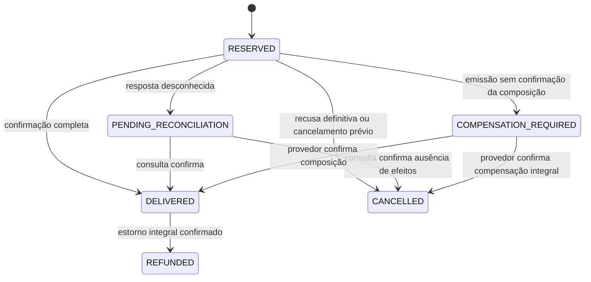

# INPAY Credits — benefícios e resgates

A separação dos quatro produtos e a migração estão em [PRODUCT_MODULES.md](PRODUCT_MODULES.md).
PROMOTIONAL/PROMOTIONAL_GRANT representa benefício sem dívida; CREDIT conserva o contrato legado.

Implementação inicial executável, separada do gateway. O serviço `credits-service` (porta 8110)
possui banco `marketplace_service`, namespace `/credits/v1`, escopos e tópico Kafka próprios.
Não altera os contratos de `/v1/payments`, conectores de adquirentes ou conciliação do gateway.
PlacarPlay é o primeiro contexto de negócio; concedente, titular, contrato e catálogo são dados por
organização, não constantes financeiras globais.

## Capacidades implementadas

- Contas de crédito por tenant e titular, bloqueio de novas compras e referência do contrato.
- Separação de limite, utilização, reserva de crédito, saldo conciliado e voucher conciliado.
- Solicitação e aprovação independente de limite, repasse, voucher e amortização por pedido.
- Evidência única por tipo de ajuste, impedindo dupla aplicação da mesma confirmação.
- Catálogo com preço definido no servidor; compra com uma ou duas fontes distintas.
- Reserva atômica, processamento, pendência, conciliação, cancelamento e estorno integral.
- Journal append-only, com pares de livros de origem/destino, e outbox na mesma transação.
- Painel administrativo e portal do titular conectados às APIs; exemplos visuais separados.
- Swagger local em `http://localhost:8110/swagger-ui/index.html`.

## Separação de módulos

| Contexto | Implementação |
|---|---|
| Contas e limites | `domain/Account`, regras de disponibilidade e reservas |
| Pedidos e composição | `Order`, `Tender`, `Source`, `OrderStatus` |
| Aprovações e repasses | `Adjustment`, solicitação e conferência por identidades distintas |
| Journal | `JournalEntry`, tabela append-only `marketplace_journal` |
| Aplicação | `CreditsService`, casos de uso e regras de transição |
| Persistência | Porta `CreditsRepository`, adaptador PostgreSQL exclusivo |
| Integrações | Porta `FulfillmentPort`; simulador local e bloqueio fora de local |
| Interfaces | APIs `/admin` e `/me`, painéis com acesso separado |

Esses contextos são módulos lógicos de um serviço isolado, não sete microsserviços artificiais.
Reservar duas fontes requer consistência atômica. O primeiro armazenamento utiliza um snapshot
JSONB por tenant com bloqueio `FOR UPDATE`, journal separado e versão crescente. Isso simplifica
correção concorrente, mas serializa escritas do tenant e não é dimensionamento para alta volumetria.
Antes de escalar, normalizar contas/pedidos e migrar os bloqueios para conta, preservando invariantes.
O journal é um subledger operacional, não contabilidade regulatória da concedente.

## Fontes e exemplo

Valores inteiros em centavos, moeda BRL nesta versão:

- `CREDIT`: limite aprovado pela concedente; utilização gera dívida operacional por pedido.
- `BALANCE`: direitos de repasses conciliados, registrados após evidência e dupla aprovação.
- `VOUCHER`: saldo de voucher do programa do tenant, verificado pelo operador. Não aceita códigos
  arbitrários nem valida cartões Steam, Xbox ou Nuuvem; elegibilidade por emissor/catálogo deve
  ser adicionada no conector contratado antes de uso real.
- `EXTERNAL`: parcela a confirmar pelo gateway na integração de fulfillment; somente simulada
  nesta versão. Não coleta PAN/CVV nem chama Cielo automaticamente.

Para um produto de R$ 100,00: `CREDIT=7000` + `BALANCE=3000`. A reserva dos dois componentes
ocorre na mesma transação. Não são aceitos valores negativos, soma divergente, fonte duplicada,
mais de duas fontes, limite insuficiente ou conta bloqueada.

```json
{
  "operationId": "2190a034-4801-4e84-b8f8-900149be9811",
  "sku": "DEMO-GAME-100",
  "tenders": [
    { "source": "CREDIT", "amount": 7000 },
    { "source": "BALANCE", "amount": 3000 }
  ]
}
```

Enviar para `POST /credits/v1/me/orders`. O titular é extraído do subject autenticado.
Não existe campo de titular livre nesse endpoint. O resultado retorna o pedido reservado.

## Estados e compensações



Timeout não libera reserva. O operador consulta evidências; não fornece um booleano arbitrário de
sucesso. Cancelamento pelo usuário só é permitido em RESERVED. Estornos retornam às fontes originais,
sem converter limite em dinheiro. Após amortização de uma compra, o estorno fica bloqueado até
implementar a destinação definida pela concedente, evitando abater dívida de outra compra.
Amortizações exigem `relatedOrder` e não podem superar seu principal em aberto.

`FulfillmentPort.REJECTED` significa ausência de qualquer efeito externo ou compensação integral
confirmada, nunca apenas falha de uma das etapas. `CONFIRMED` significa todas as fontes confirmadas
mais entrega confirmada. Essa semântica é obrigatória para futuros adaptadores reais.

## Execução local

```bash
docker compose up --build -d credits-service inpay-panel
python3 scripts/seed-credits-local.py
```

O compose inicia PostgreSQL/Kafka pelas dependências do serviço. Para volumes PostgreSQL anteriores
à mudança, o init SQL não é reexecutado: crie o usuário/banco `marketplace_service` com o administrador
ou migre o ambiente. Não apague volumes com dados para resolver isso.

Painel: `http://localhost:3080`. Em Configurações, escolha modo conectado sem bearer para usar as
identidades fixas locais. Abra **Créditos e saldos** ou **Meu crédito e compras**.

- `developer`: administração e operação; pode solicitar alterações.
- `reviewer`: administração e aprovação; deve aprovar pedidos de outro usuário.
- `customer`: apenas o portal do titular.

Senha: `LOCAL_PASSWORD`, padrão exclusivamente local `inpay@123`. O BFF usa developer
nas rotas administrativas e customer em `/me` somente no perfil local; nunca substitui um bearer
informado. Para aprovar como reviewer no ambiente local, use Swagger/HTTP Basic. O BFF não assume
uma segunda identidade para burlar a dupla aprovação. O seed utiliza as duas identidades de teste
explicitamente e não deve ser tratado como evidência de aprovação humana em produção.

Cenários por fornecedor local: `SIMULATED`, `SIMULATED_TIMEOUT`, `SIMULATED_REJECT` e
`SIMULATED_CAPTURE_FAILURE`. Nenhum gera código comercializável. Timeout simulado é confirmado
na consulta seguinte; compensação simulada permanece pendente para evidenciar o bloqueio.

## Segurança e Cognito

Fora de local: access token Cognito RS256, issuer, client_id permitido e token_use validados.
Configurar `COGNITO_ISSUER`, `COGNITO_ALLOWED_CLIENTS`, `COGNITO_CLIENT_TENANTS` e, se aplicável,
`COGNITO_AUDIENCE`. Habilitar cada tenant em `CREDITS_ENABLED_TENANTS`; vazio bloqueia todos.

| Acesso | Escopo | Grupo necessário para equipe |
|---|---|---|
| Gestão | `credits/admin` | `credits-admin:<tenant-uuid>` |
| Aprovação | `credits/approve` | `credits-approve:<tenant-uuid>` |
| Processamento/estorno | `credits/operate` | `credits-operate:<tenant-uuid>` |
| Titular | `credits/customer` | identidade de usuário; subject vinculado à conta |

Não basta obter um escopo no app client para se tornar administrador. Equipe exige grupo por tenant;
cliente M2M sem username é rejeitado nesses fluxos. Atribuição de grupos é administrativa fora do portal.
O Terraform adiciona o resource server marketplace e app clients opcionais de authorization code
sem client secret via `marketplace_portals`; usar PKCE. O painel atual recebe um access token em
memória, como os demais módulos. Login hospedado/refresh automático ainda não está implementado.

## APIs administrativas

Todos os POST exigem `operationId` UUID. Reuso com identidade ou corpo diferente é rejeitado.

| Método | Caminho após `/credits/v1` | Finalidade |
|---|---|---|
| GET | `/admin` | Contas, catálogo, pedidos, aprovações e últimos 500 lançamentos |
| POST | `/admin/accounts` | Cadastro com owner, creditor, contract |
| POST | `/admin/accounts/block` | Bloqueio de compras novas |
| POST | `/admin/products` | Oferta e preço definidos pelo servidor |
| POST | `/admin/adjustments` | CREDIT_LIMIT, SETTLED_REPASS, VERIFIED_VOUCHER ou CREDIT_REPAYMENT |
| POST | `/admin/adjustments/{id}/approve` | Conferência independente |
| POST | `/admin/orders/{id}/process` | Processar reserva |
| POST | `/admin/orders/{id}/reconcile` | Consultar resultado pendente |
| POST | `/admin/orders/{id}/refund` | Estorno integral confirmado |
| GET | `/me` | Apenas conta, compras e extrato do titular; catálogo ativo |
| POST | `/me/orders` | Compra com uma ou duas fontes |
| POST | `/me/orders/{id}/cancel` | Cancelar reserva própria antes do envio |

O browser conserva a chave do comando em memória após erro para reaproveitá-la na repetição do
mesmo corpo. Após reload, consultar pedidos antes de repetir. Integrações devem persistir suas chaves.

## Limites reais da entrega

Esta versão funciona com API, PostgreSQL e regras de composição reais, mas fulfillment simulado.
`UnavailableFulfillmentAdapter` bloqueia processamento, conciliação externa e estorno em produção.
Não existe contrato de API Nuuvem fornecido nesta conversa; nenhuma URL/autenticação foi inventada.
Repasses e vouchers entram mediante revisão de evidência, não webhook autenticado Nuuvem automático.

Antes de movimentar valores reais: implementar protocolo contratado, confirmação do gateway,
liquidação ao fornecedor, consulta idempotente, assinatura/replay de callbacks, elegibilidade dos
vouchers, proteção de códigos, política de crédito e validação operacional da PlacarPlay.
O adaptador real deverá usar uma saga durável com intenção persistida antes de I/O, leases por
etapa e reconciliação após crash. Não colocar chamadas reais dentro da transação usada pelo simulador.

Também não fazem parte desta entrega: concessão automática, juros/CET/tributos, calendário de parcelas,
contratação eletrônica, cobrança jurídica, saques/P2P, contabilidade regulatória, ou alegação de dispensa
regulatória. A UI identifica os limites em vez de apresentar parcelas ou códigos fictícios como reais.

## Verificação

`mvn -pl services/credits-service -am test` executa PostgreSQL embarcado (usuário não-root),
HTTP autenticado e testes de concorrência, rollback, dupla aprovação, titularidade, grupos Cognito,
imutabilidade, outbox, timeout, compensação, estorno e amortização por pedido.
`npm test` e `npm run build` em `frontend/` verificam o proxy e a aplicação.
