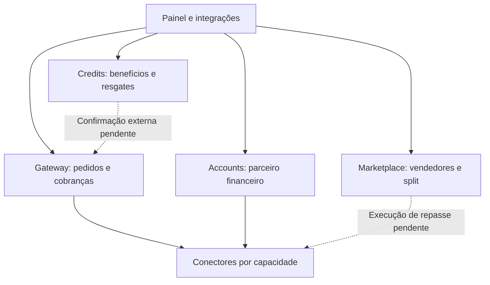

# InPay — quatro módulos de produto

## Limites e responsabilidades

| Produto | Agregador Maven | Serviço principal | API | Porta local |
|---|---|---|---|---|
| INPAY Gateway | `modules/gateway` | `payment-core-service` e serviços de adquirência existentes | `/gateway/v1` | 8084 |
| INPAY Accounts | `modules/accounts` | `accounts-service` | `/accounts/v1` | 8111 |
| INPAY Marketplace | `modules/marketplace` | `marketplace-service` | `/marketplace/v1` | 8112 |
| INPAY Credits | `modules/credits` | `credits-service` | `/credits/v1` | 8110 |

Os agregadores são módulos Maven de produto, não um único processo por produto. Serviços existentes
continuam separados. Bibliotecas comuns e Lambdas ficam na raiz e não detêm saldos de negócio.
Cada serviço usa seu próprio datasource. Não existe consulta SQL entre produtos.

- Gateway: clientes comerciais, pedidos, cobranças, cartões, cobrança Pix e conectores de adquirentes.
- Accounts: abertura PF/PJ, saldo bancário, extrato, transferências e chaves por parceiro Banking.
- Marketplace: vendedores, planos de split, conciliação comercial e repasses.
- Credits: benefícios promocionais, vouchers, resgates e composição de fontes para produtos elegíveis.

**Conta financeira não é cliente comercial nem conta de benefícios.** Não abrir Accounts ao cadastrar
um cliente Gateway. Não somar saldo bancário, direitos de repasses e crédito promocional.



As arestas pontilhadas são integrações futuras; não representam chamadas já executadas.

## APIs inspiradas no modelo Pagar.me

Referências oficiais consultadas:
- https://docs.pagar.me/reference/criar-pedido-2
- https://docs.pagar.me/reference/cobran%C3%A7as-1
- https://docs.pagar.me/reference/pix-2

A inspiração é a separação cliente → pedido → cobranças e instruções por meio de pagamento.
InPay usa Cognito e versionamento próprio; **não é uma implementação compatível com a API Pagar.me**.
Não usamos o namespace `/core/v5` nem copiamos sua autenticação.

| Método e recurso Gateway | Situação |
|---|---|
| POST/GET `/gateway/v1/customers` | Cadastro idempotente e listagem paginada |
| GET `/gateway/v1/customers/{id}` | Consulta com isolamento de tenant |
| POST/GET `/gateway/v1/orders` | Registro atômico de itens e até duas cobranças; listagem |
| GET `/gateway/v1/orders/{id}` | Consulta do pedido |
| GET `/gateway/v1/charges` e `/{id}` | Consulta das cobranças criadas no pedido |
| POST `/gateway/v1/charges/{id}/capture` | Contrato publicado; execução retorna 501 |
| DELETE `/gateway/v1/charges/{id}` | Contrato de cancelamento/estorno; retorna 501 |
| GET `/gateway/v1/providers` | Inventário técnico central; não prova habilitação comercial |

POST de pedido retorna **202, pending/not_dispatched**. Ainda não há saga que consuma esse pedido,
resolva o token, escolha o provedor, execute Pix/cartão e confirme o resultado. Logo, não há QR Pix
fictício nem pedido marcado como pago. Os endpoints nativos dos conectores permanecem disponíveis
com sua configuração anterior; não são equivalentes a uma compra ponta a ponta pelo Gateway.

Valores são inteiros em centavos, BRL. Cartões usam `card_token` opaco; Pix usa `expires_in`.
`Idempotency-Key` é obrigatório em criações: mesma chave/corpo repete recurso; corpo diferente retorna
409. Pedidos e cobranças são gravados com outbox na mesma transação PostgreSQL.
Listagens usam `page` (a partir de 1) e `size` (1–100). IDs são strings opacas.

Exemplo após cadastrar cliente:

```json
{
  "code": "PED-1001",
  "customer_id": "cus_IDENTIFICADOR_RETORNADO",
  "items": [{"code": "GAME-100", "description": "Produto digital", "amount": 10000, "quantity": 1}],
  "payments": [{"payment_method": "pix", "amount": 10000, "pix": {"expires_in": 600}}]
}
```

Swagger local: `/swagger-ui/index.html` na porta de cada serviço. No Gateway há grupos
`gateway-v1` e `legacy-payments`; `/v1/payments` continua atendendo clientes anteriores.
O contrato antigo não foi silenciosamente alterado para simular uma cobrança moderna.

## Provedores e Pix

`ProviderRegistry` em `libs/contracts` centraliza capacidades: CARD_PAYMENTS, PIX_COLLECTION,
PIX_REFUND, SPLIT, BANK_ACCOUNTS, PIX_TRANSFER e PIX_KEYS. A seleção exige implementação da
capacidade, habilitação e vínculo ao tenant. Habilitar uma flag não cria uma integração ausente.
O registro identifica os adaptadores existentes de cartão; a rota pública informa `routing_enabled=false`.

**Nenhum adaptador Pix normalizado foi habilitado nesta mudança.** Um provedor aceitar Pix em seu
produto comercial não significa que nosso adaptador implemente cobrança, consulta, expiração,
assinatura de webhook e devolução. Essas capacidades devem ser homologadas antes de registro.
Não presumir que um adquirente com cobrança Pix ofereça contas ou operações DICT.
Credenciais e endpoints externos continuam em resources de cada conector, via variáveis/Secrets
Manager. Nenhuma credencial foi movida para UI ou catálogo público.

## Accounts e Marketplace

Accounts oferece contratos de abertura, consulta, saldo, extrato, transferências e chaves por meio da
porta `BankingPort`. O adaptador atual retorna **503 BANKING_PARTNER_NOT_CONFIGURED**, inclusive local.
Não foi fornecida documentação/contratação do parceiro. Um adaptador real deve verificar vínculo da
conta ao tenant, guardar correlação com IDs externos, executar KYC específico, validar titularidade,
idempotência, limites, confirmação Pix e webhooks; não basta retornar dados arbitrários de uma API.

Marketplace registra vendedores (`recipients`), planos (`split-plans`) e revisão de liquidação
(`settlements`). Split valida soma exata, fontes positivas e recebedores distintos do mesmo tenant.
Recebedores ficam `pending_verification`, splits `planned` e evidências `pending_reconciliation`.
`POST /settlements/{id}/payouts` retorna 501 até haver liquidação comprovada e executor integrado.
Referências de pedido e recebedor externo são correlações, não prova de pagamento ou KYC concluído.

## Credits e compatibilidade

`PROMOTIONAL` é benefício sem dívida; `VOUCHER` é direito de resgate verificado. A concessão
`PROMOTIONAL_GRANT` usa a mesma dupla aprovação e evidência única. Estorno preserva a fonte original.
`CREDIT` conserva o crédito contratual legado solicitado anteriormente, sem reclassificar dívidas
existentes como promoção. `BALANCE` conserva direitos conciliados do usuário, não saldo bancário.
Novas liquidações comerciais de vendedores pertencem a Marketplace. Nenhum repasse comercial deve
creditar benefícios automaticamente. A conexão entre produtos exige contrato/evento específico.

Credits mantém os pedidos de **resgate** existentes e sua simulação de fulfillment; não hospeda pedidos
comerciais genéricos. Nuuvem, gift cards negociáveis e confirmação externa real continuam pendentes.
Não há conversão implícita entre benefício, dinheiro bancário e crédito contratual.

## Atualização segura de ambiente existente

1. Pare o antigo `marketplace-service` na porta 8110 antes de subir Credits. Não execute ambos sobre
   o mesmo banco. Preserve backup e histórico Flyway.
2. `credits-service` reutiliza `marketplace_service` e tabelas `marketplace_state`/`marketplace_journal`
   intencionalmente. As migrações existentes são preservadas byte a byte; não apague dados.
3. Crie usuário/banco `accounts_service` e `commerce_marketplace` em volumes PostgreSQL existentes;
   o init SQL só roda em volumes novos. Nunca use `down -v` como migração.
4. Atualize clientes da antiga `/marketplace/v1/admin|me` para `/credits/v1/admin|me` na porta 8110.
   O novo Marketplace (8112) não expõe as rotas de benefícios. Esta é uma migração explícita, sem alias
   que possa confundir dinheiro de vendedores e benefícios de usuários.
5. Migre scopes/grupos `marketplace/admin|approve|operate|customer` para `credits/...`, e grupos
   `credits-admin:<tenant>` etc. Configure `CREDITS_ENABLED_TENANTS`. Mapeamento de client_id para tenant
   permanece obrigatório. O recurso Terraform `marketplace_portal` conserva endereço para evitar
   recriação de app clients, mas passa a solicitar scopes Credits. Revise o plano Terraform antes do deploy.
6. Novo Marketplace usa `marketplace/read|write`; Accounts usa `accounts/read|write|transfer`.
   Credenciais locais são exclusivamente de desenvolvimento; não se aplicam à produção.
7. Crie tópicos novos `inpay.credits.events.v1` e `inpay.gateway.events.v1`. Preserve o tópico anterior
   e processe a outbox pendente; consumidores antigos não são migrados automaticamente.

```bash
docker compose up --build -d credits-service accounts-service marketplace-service payment-core-service inpay-panel
python3 scripts/seed-credits-local.py
```

O painel tem entradas separadas para os quatro produtos. Credits conserva a gestão operacional.
Accounts e Marketplace possuem consultas iniciais; os cadastros completos desses novos produtos
estão na API/Swagger, não em formulários completos do painel.

## Limites operacionais

Esta entrega reorganiza produtos e amplia contratos, persistência e documentação. Não conclui a
homologação Pix/Banking/Nuuvem, a saga do Gateway, a execução de repasses nem o login Cognito hospedado.
Recorrência, disputa/chargeback, tokens de rede e todos os recursos Pagar.me não foram replicados.
A separação técnica não afirma dispensa regulatória. Políticas de retenção de dados pessoais,
criptografia em repouso e autorização operacional precisam acompanhar o ambiente de produção.
